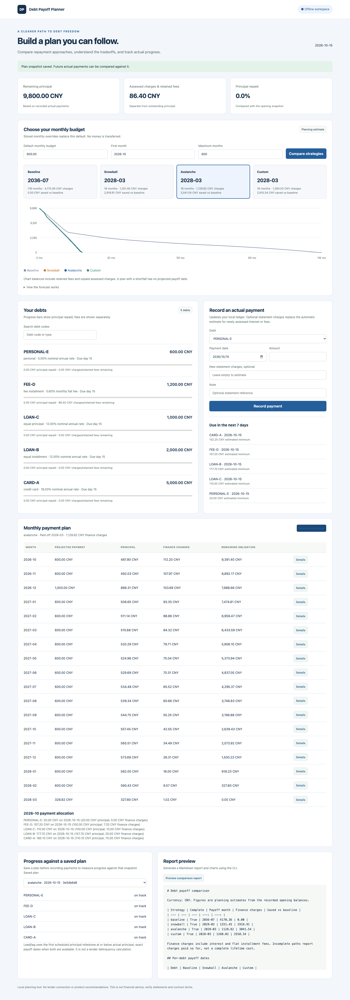

# Debt Payoff Planner

Compare debt snowball, avalanche, custom-priority, and minimum-only repayment plans on your own computer. Track actual payments separately from forecasts, inspect finance charges, and see when a budget cannot support the required payments.

Python 3.11+ · SQLite · CLI · MCP stdio · offline Web dashboard · MIT



## Install

```bash
git clone https://github.com/GuoHaoyu1688/debt-payoff-planner.git
cd debt-payoff-planner
python3 -m venv .venv
. .venv/bin/activate
python -m pip install -e .
```

Installation downloads open-source dependencies. The installed application runs locally without API keys, bank connections, telemetry, product recommendations, or runtime internet access. It never transfers money. The Web server binds to loopback only.

## Three-command quick start

After installation, run these from the repository root:

```bash
debt --config examples/config.yaml import examples/five_debts.json --json
debt --config examples/config.yaml compare --budget 600 --start 2026-10 --json
debt --config examples/config.yaml report --budget 600 --start 2026-10 --md --json
```

The fictional example has five debts totaling **9,800.00 CNY principal**, plus **86.40 CNY retained installment fees**. The default monthly budget is 600; a stored December 2026 override raises that month's total budget to 1,000. Import creates five debts and one budget override. Repeating the unchanged import skips identical records.

| Strategy | Payoff month | Months | Finance charges | Saved vs baseline |
| --- | --- | ---: | ---: | ---: |
| Minimum-only baseline | 2036-07 | 118 | 4,170.36 CNY | 0.00 CNY |
| Snowball | 2028-03 | 18 | 1,251.45 CNY | 2,918.91 CNY |
| Avalanche | 2028-03 | 18 | 1,128.82 CNY | 3,041.54 CNY |
| Custom priority | 2028-03 | 18 | 1,260.02 CNY | 2,910.34 CNY |

The exact comparison snapshot, including each debt's payoff date, is in [examples/expected_comparison.json](examples/expected_comparison.json). Tests verify it. The Markdown report and two charts are written to `data/demo/reports/`.

```bash
debt --config examples/config.yaml serve --port 8768
```

Open `http://127.0.0.1:8768`. Compare strategies, select a monthly plan, inspect debt allocations, search debts, save a plan, record an actual payment, and compare progress with the saved snapshot. Desktop and mobile layouts use local HTML/CSS/JS without a build step or CDN. `/openapi.json` describes the local API.

## Debt models

Every amount uses integer cents in storage and output. Input money is a decimal string with at most two decimal places. All debts share the configured two-decimal reporting currency; there is no FX conversion. Annual interest is a **nominal rate**, distinct from fee-inclusive IRR or effective annual yield.

`start_date` is the date of the **opening principal snapshot**. Enter the outstanding balance and remaining term at that date. Use the original borrowing date only when you will also enter the complete payment history from that date. The first due date is the first configured due day on or after the snapshot date. Days 29–31 clamp at the end of shorter months.

| Type | Required parameters and monthly convention |
| --- | --- |
| `credit_card` | Annual/daily rate; `minimum_ratio` defaults to 10%. Minimum is the greater of the specified cash minimum and the ratio of principal plus assessed charges. Optional explicit `grace_until` suppresses monthly interest through that due date. |
| `equal_installment` | Remaining `term_months` and rate. Fixed principal-and-interest payment from the amortization formula; the last payment clears rounding residue. |
| `equal_principal` | Remaining `term_months` and rate. Fixed principal step plus interest on the remaining principal. |
| `interest_only` | Maturity date or term. Interest-only payments until all remaining principal becomes due in the maturity month. |
| `fee_installment` | Remaining term and monthly flat `fee_rate` applied to original snapshot principal. Nominal interest is zero; fees still have a real financing cost. |
| `personal` | Flexible borrowing, optionally interest-free. User-supplied minimum; an optional maturity date makes the remainder due then. |

`--minimum` is a cash floor on the computed requirement. Priority is a nonnegative integer; smaller numbers come first. Tags are not used; store context in `--note`. No model adds new borrowing, late fees, penalty rates, insurance, or taxes.

### Amortization and independent checks

For principal `P`, monthly nominal rate `r = annual_rate / 12`, and `n` remaining installments:

- Equal installment: `A = P × r / (1 − (1+r)^(-n))`; for zero interest, `A = P/n`.
- Equal principal: monthly principal step `P/n`, plus that month's interest on remaining principal.
- Interest rounds `ROUND_HALF_UP` to cents each month. The final maturity payment clears the exact remaining principal and charges.

Example: `P = 1,200`, annual rate 12%, and two installments gives a rounded regular payment of 609.01. First-month interest is 12.00, leaving 602.99 principal; next interest is 6.03, so the final payment is **609.02**, not 609.01. Total interest is 18.03. Equal principal over three months gives payments of 412.00, 408.00, and 404.00, totaling 24.00 interest. These independent arithmetic cases are asserted in tests.

The CFPB explains the separation between principal and interest and how the interest share decreases under amortization. The formulas above implement a fixed monthly planning model consistent with those principles. [CFPB: amortization](https://www.consumerfinance.gov/ask-cfpb/what-is-amortization-and-how-could-it-affect-my-auto-loan-en-771/), [CFPB: paying down a mortgage](https://www.consumerfinance.gov/ask-cfpb/how-does-paying-down-a-mortgage-work-en-1943/).

### Flat fees, APR, and IRR

```bash
debt apr --fee-rate 0.6% --months 12 --json
debt apr --fee-rate 7.2% --months 12 --fee-mode total --json
debt apr --fee-rate 5% --months 12 --fee-mode upfront --json
debt apr --daily-rate 0.05% --json
```

The default fee calculator assumes a monthly fee on the original principal and equal month-end principal repayments. `total` spreads one total fee over the installments; `upfront` subtracts the fee from the initial amount advanced. A bounded Decimal bisection solves the discounted cash-flow equation. Results separately expose **monthly IRR**, **nominal annualized IRR (`12 × monthly IRR`)**, and **effective annual rate (`(1 + monthly IRR)^12 − 1`)**. These are planning yields, not jurisdiction-specific legal APR disclosures. The CFPB likewise distinguishes a loan's interest rate from a broader APR measure that includes applicable fees. [CFPB: interest rate and APR](https://www.consumerfinance.gov/ask-cfpb/what-is-the-difference-between-a-loan-interest-rate-and-the-apr-en-733/).

A daily rate of `0.05%` converts to a nominal annual rate of **18.25%** using 365 days. Its effective annual yield is higher if interest compounds daily. The repayment simulator uses nominal annual / 12; it does not pretend to calculate statement-specific daily accrual.

Fee installments default to `--fee-policy retain`: unassessed future fees remain owed after principal is repaid, and additional money can prepay those fees. `--fee-policy waive` cancels unassessed fees once principal reaches zero. Verify the lender's contract before selecting waiver. For a 1,200 principal installment with a 0.6% monthly fee over 12 months, total retained fees are 86.40. Immediate principal repayment does not magically save those retained fees. With waiver, a first-month full payoff costs 1,207.20 instead of 1,286.40.

## Strategies, variable budgets, and failure behavior

All strategies first satisfy every debt's required minimum and maturity obligation. Snowball then prioritizes the smallest remaining obligation; avalanche prioritizes the highest nominal interest rate (fee debt uses its nominal annualized IRR); custom uses numeric priority or an explicit complete code order. Ties are deterministic. Baseline pays only required minimums. Fixed payments/principal steps are preserved after extra payments, shortening the term rather than automatically reducing future installments.

```bash
debt budget set 2026-12 --amount 1000 --json
debt simulate --strategy custom --budget 600 --start 2026-10 --order PERSONAL-E,FEE-D,LOAN-C,LOAN-B,CARD-A --save --json
debt extra --amount 1000 --month 2026-12 --budget 600 --start 2026-10 --json
```

A stored budget is a **replacement total for that month**, not an addition. Unused budget is not carried forward. Actual payments already recorded in a simulated month consume that month's total budget. The extra-payment evaluator adds funds in the selected month, satisfies minimums, directs available extra funds to each candidate, and compares complete outcomes. Surplus follows the chosen strategy. A target already settled before it can receive extra money is marked ineligible.

If a budget cannot cover minimums or a balloon, simulation stops before that month's projected payments and returns `complete: false`, `failure.code: MINIMUM_BUDGET_SHORTFALL`, and the exact required/available/shortfall amounts. The horizon defaults to 600 months and is capped at 1,200. Unpaid balances at the bound produce `HORIZON_EXCEEDED`; there is no infinite loop. A zero-minimum, interest-free personal debt never clears under baseline unless it has a maturity date. Incomplete baselines produce **null savings**, not a fabricated zero or a comparison against partial lifetime costs.

The JSON envelope can have `ok: true` for a successfully computed **infeasible** scenario. Always inspect `data.complete` and `data.failure`. An exit code of zero alone does not mean a repayment plan is affordable.

## Actual payments and progress

```bash
debt pay CARD-A --amount 200 --date 2026-10-10 --interest 70 --idempotency-key fictional-statement-1 --json
debt payments --json
debt plans --json
debt progress --plan PLAN_ID --as-of 2026-10-15 --json
debt due --within 7d --json
```

Payment allocation is assessed finance charges first, principal second, retained future fees last. The journal stores the original amount, principal/finance-charge split, and before/after balance snapshots. Payments must be chronological, cannot be future-dated, and cannot exceed the remaining obligation. Retry keys deduplicate identical requests and reject changed content.

Without `--interest`, the first actual payment in a month estimates newly accrued monthly charges from the opening/last-assessed month; subsequent payments do not charge that month twice. Missing months accrue charges on the unchanged recorded principal. Unpaid assessed charges remain separate and do not compound. `--interest` supplies **newly assessed charges** from a statement, replacing this estimate; it does not erase previously assessed unpaid charges. For fee installments, `interest_cents` includes fees. Use the statement override whenever lender timing differs from this monthly model.

The model does not reconstruct overdue contractual principal installments or a lender's arrears accounting. Start with a current opening snapshot, include actual statement minimums/arrears in your inputs, and verify lender notices. Credit-card grace is a simplified explicit date, with no retroactive grace-loss interest or new purchases.

Save a plan before recording payments. Principal progress is measured against that immutable snapshot. Lead/lag in days uses the first scheduled principal milestone at or below actual principal; where actual and planned payoff dates both exist, their day difference is exact. This is a planning milestone comparison, not a lender delinquency calculation. Progress bars show principal repayment only; retained fees may still remain when principal reaches zero.

## CLI reference

Global flags work before or after subcommands: `--data-dir`, `--config`, `--json`, `--quiet`, `--progress`, `--version`. Every command is noninteractive; no TTY is required. Normal output is a single JSON object; progress logs go to stderr.

| Command | Arguments |
| --- | --- |
| `init`, `list` | Initialize storage / list current debt snapshots |
| `add` | `--code --type --balance [--annual-rate 12% \| --daily-rate 0.05%] [--minimum] [--due-day 15] [--start-date] [--maturity-date] [--term-months] [--priority] [--note] [--fee-rate] [--fee-policy retain\|waive] [--minimum-ratio] [--grace-until]` |
| `update ID_OR_CODE` | `--data '{"minimum":"120","priority":1}'`; supports annual_rate, minimum, due_day, maturity_date, priority, note, minimum_ratio, grace_until, fee_policy |
| `pay ID_OR_CODE` | `--amount --date [--interest] [--note] [--idempotency-key]` |
| `payments` | Read the actual payment journal |
| `budget set MONTH` / `budget list` | `set` requires `--amount`; repeat replaces that month's total |
| `simulate` | `--strategy snowball\|avalanche\|custom\|baseline [--budget] [--start YYYY-MM] [--months 600] [--order A,B] [--save]` |
| `compare` | `[--budget] [--start] [--months] [--order]` |
| `extra` | `--amount --month [--budget] [--start] [--strategy avalanche] [--months]` |
| `apr` | `--fee-rate [--months 12] [--fee-mode monthly\|total\|upfront]`, or `--daily-rate` |
| `due` | `[--within 7d] [--as-of DATE]` |
| `plans`, `progress` | Progress requires `--plan ID`; optional `--as-of DATE` |
| `report` | `[--budget] [--start] [--months] [--md] [--out PATH]` |
| `import FILE` | JSON or CSV snapshot import |
| `export` | `--format json\|csv --out PATH [--utf8]` |
| `backup` | `[--out PATH]`; defaults to dated ZIP |
| `serve` | `[--host 127.0.0.1] [--port 8768]`; loopback only |
| `mcp` | Official SDK stdio service |

Budget can come from `--budget` or a configured `default_budget`. A missing default is an argument error; the application never silently guesses an affordable amount. Changing an equal-installment rate recomputes its payment from current principal and remaining calendar term; other payment history remains unchanged. Direct balance edits and payment deletion are not provided. Restore a prior backup to correct a mistaken journal entry.

Success: `{"ok":true,"data":...,"warnings":[]}`. Errors: `{"ok":false,"error":{"code":"INVALID_ARGUMENT","message":"..."}}`. Exit codes: 0 command success, 1 I/O/database failure, 2 invalid or conflicting input, 3 missing debt/plan. Long chart generation may initialize the local Matplotlib font cache on first use; `--progress` reports execution on stderr.

## Configuration, interchange, and backup

```yaml
data_dir: ./data
timezone: Asia/Shanghai
currency: CNY
default_budget: '600.00'
```

Data directory precedence is CLI → `DEBT_DATA_DIR` → YAML → `./data`. `--config` overrides `DEBT_CONFIG`. Relative YAML paths resolve beside the config; relative CLI/environment paths resolve from the working directory. Storage is `debts.db`, with `debts`, `payments`, `budgets`, and `plans` tables. Runtime data and `.coverage*` are ignored by Git.

JSON exports are arrays of objects with `record_type` identifying one of those four tables. CSV uses the same columns and defaults to UTF-8 BOM; `--utf8` omits it. Monetary columns are integer `_cents`, rates are decimal strings, and payment/plan JSON snapshots are serialized strings. All records need stable IDs, except budgets keyed by month. [examples/five_debts.json](examples/five_debts.json) is a complete reusable fixture.

Import is an atomic **snapshot operation**: it imports balances and journal records together, and never subtracts principal a second time. Identical IDs are skipped; conflicting content aborts the entire import. Payment splits must reconcile, and each final debt balance must match its latest payment snapshot. Import a modified snapshot into a fresh data directory rather than overwriting an active ledger. Treat CSV code/note columns as text when opening with spreadsheet software.

`backup` uses SQLite's online backup API and writes a dated ZIP with `debts.db` and `settings.json`. To restore, stop ledger processes, extract into a fresh directory, translate the saved settings into YAML or command arguments, and point `--data-dir` there. Never replace a live database. Back up before changing debt assumptions, budget overrides, restoring snapshots, or correcting actual-payment history. Reports use deterministic date-containing names and overwrite the corresponding previous report.

## MCP for agents

```json
{
  "mcpServers": {
    "debt-planner": {
      "command": "/workspace/apps/debt-payoff-planner/.venv/bin/debt",
      "args": ["--data-dir", "/workspace/data/debt-payoff-planner", "mcp"]
    }
  }
}
```

Tools share the exact CLI core: `list_debts`, `simulate_plan(strategy, budget, start=null, months=600, order=null)`, `compare_strategies(budget, start=null, months=600)`, `record_payment(debt_id, amount, date, interest=null, note="", idempotency_key=null)`, and `upcoming_payments(days=7, as_of=null)`. `record_payment` writes locally; other tools are read-only. Inputs use decimal strings and ISO dates, outputs use integer cents, and invalid inputs become MCP tool errors. Stdio never logs normal text to stdout. See [AGENTS.md](AGENTS.md) for headless installation and recipes.

## Validation, FAQ, and roadmap

```bash
python -m pip install -e '.[dev]'
ruff check .
ruff format --check .
pytest -q --cov=debt_payoff_planner --cov-report=term-missing
```

CI runs Python 3.11 and 3.12 on Ubuntu. Independent tests cover amortization, equal principal, balloons, grace, flat-fee IRR, actual payments, budget shortfalls, bounded failure, concurrent idempotency, import/export/backup, the five-debt report snapshot, every MCP tool, a real stdio handshake, and REST. Browser acceptance is recorded in [docs/VALIDATION.md](docs/VALIDATION.md).

**Why are savings unavailable?** At least one compared path is incomplete. Partial finance charges cannot represent a full lifetime cost.

**Why did an extra fee-installment payment save no fees?** Retained fees remain owed. Select waiver only when the contract supports it.

**Why is my statement different?** Day-count methods, grace rules, penalties, variable rates, and arrears differ by lender. Use actual statement charges and minimums; this model does not certify a lender's payoff quote.

**Can multiple currencies or remote users share a ledger?** This release uses one configured two-decimal currency and a trusted local user. There is no authentication or multi-currency conversion. Do not expose the server to an untrusted network.

Roadmap: explicit arrears schedules, lender-specific day-count/grace conventions, statement reconciliation, payment correction entries, and optional encrypted backups. No lender integrations or product recommendations are planned.

This is a planning and recordkeeping tool, **not financial advice**. Verify contractual terms and actual statements before making financial decisions. MIT license; see [LICENSE](LICENSE) and [CHANGELOG.md](CHANGELOG.md).
